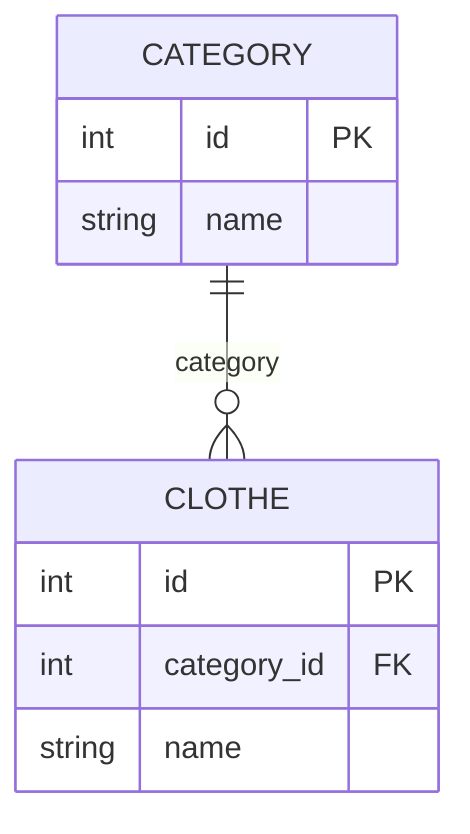
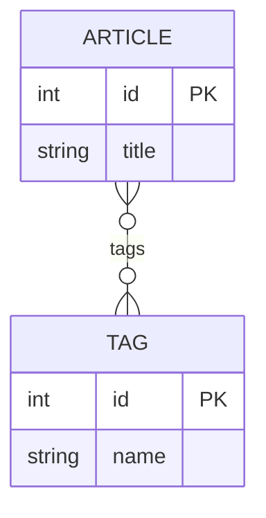
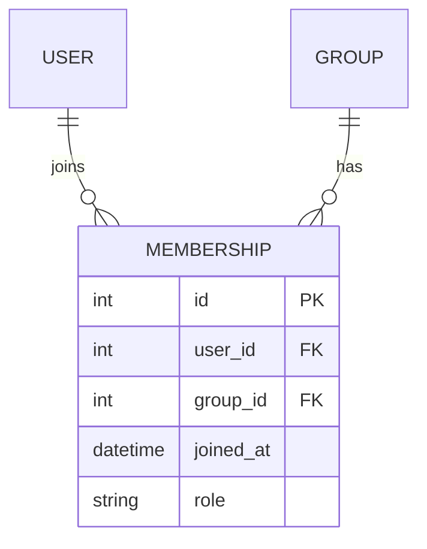
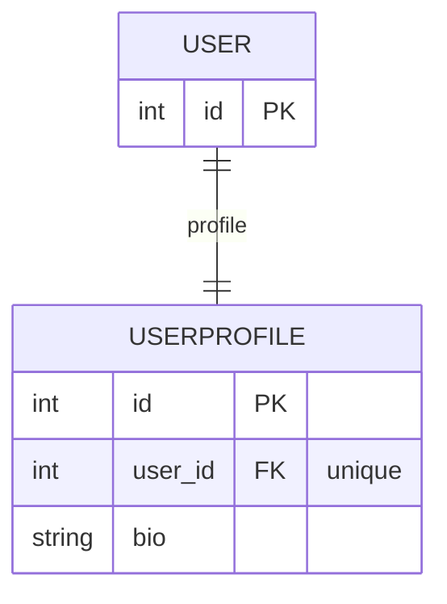
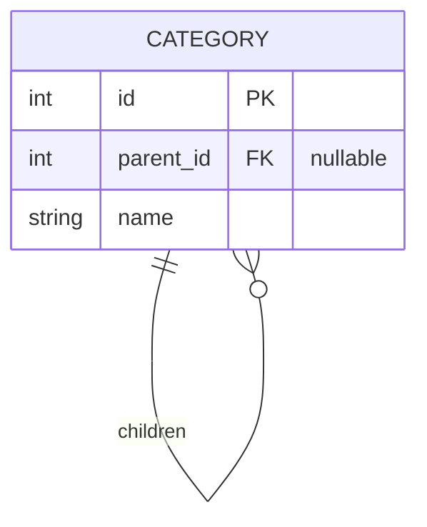

<!-- ramani: app/learn/django/01-django-models.md -->
⬅️ [Back to Backend Notes](README.md)

---

# Django: Models

## Contents

- [What is a Model?](#what-is-a-model)
  - [Defining a Model](#defining-a-model)
  - [How Models Connect to the Rest of Django](#how-models-connect-to-the-rest-of-django)
  - [Common Field Types](#common-field-types)
  - [Field Options](#field-options)
  - [Choices](#choices)
- [Relationships](#relationships)
  - [ForeignKey](#foreignkey)
  - [ManyToManyField](#manytomanyfield)
  - [OneToOneField](#onetoonefield)
  - [Self-referential ForeignKey](#self-referential-foreignkey)
- [The Meta Class](#the-meta-class)
  - [Defining database-level metadata](#defining-database-level-metadata)
  - [Proxy Models](#proxy-models)
  - [models.Q — Database Conditions](#modelsq--database-conditions)
- [Properties and Methods](#properties-and-methods)
  - [Defining properties](#defining-properties)
  - [Defining Methods](#defining-methods)
  - [The save() Method](#the-save-method)
  - [The clean() Method](#the-clean-method)
  - [clean() vs save() — when to use which](#clean-vs-save--when-to-use-which)
- [QuerySet API](#queryset-api)
  - [Creating objects](#creating-objects)
  - [Reading objects](#reading-objects)
  - [Lookups](#lookups)
  - [Ordering and slicing](#ordering-and-slicing)
  - [Updating objects](#updating-objects)
  - [Deleting objects](#deleting-objects)
  - [F objects — referencing field values](#f-objects--referencing-field-values)
  - [Aggregation](#aggregation)
  - [Shaping output](#shaping-output)
  - [Reducing database queries](#reducing-database-queries)
  - [Partial loading](#partial-loading)
- [Managers and QuerySets](#managers-and-querysets)
- [Validators](#validators)
  - [When validators run — and when they don't](#when-validators-run--and-when-they-dont)
  - [Validators vs CheckConstraint](#validators-vs-checkconstraint)
  - [Built-in validators](#built-in-validators)
  - [Custom validators](#custom-validators)
- [Migrations](#migrations)
- [Fixtures](#fixtures)
- [Signals](#signals)
  - [Defining a signal](#defining-a-signal)
  - [save() vs Signals — When to Use Which](#save-vs-signals--when-to-use-which)
- [Database Management Commands](#database-management-commands)
- [References](#references)

---

## What is a Model?

### Defining a Model

A model is a Python class that maps directly to a database table. Each class attribute is a column. Each instance of the class is a row. Django writes all the SQL for you — you never touch `CREATE TABLE` or `INSERT INTO` directly.

```
Model class      →  Database table
Field/Attribute  →  Column
Instance         →  Row
```

```python
from django.db import models


class Article(models.Model):
    title = models.CharField(max_length=200)
    body = models.TextField()
    published = models.BooleanField(default=False)
    created_at = models.DateTimeField(auto_now_add=True)
    updated_at = models.DateTimeField(auto_now=True)

    def __str__(self) -> str:
        return self.title
```

Always define `__str__` — it controls how the object appears in the shell, the admin, and anywhere Django renders the object as a string (like a dropdown in a form).

[↑ Back to Contents](#contents)

---

### How Models Connect to the Rest of Django

Models don't live in isolation. Once you define a model, every other part of Django builds on it:

```
              ┌─────────────┐
              │   Model     │  ← you define fields and business logic here
              └──────┬──────┘
                     │
       ┌─────────────┼─────────────────────────┐
       │             │                         │
  ┌────▼────┐   ┌────▼────┐            ┌───────▼──────┐
  │  Forms  │   │  Admin  │            │   QuerySet   │
  │         │   │         │            │   (views,    │
  │ModelForm│   │ModelAdmin│           │  commands)   │
  └─────────┘   └─────────┘            └──────────────┘
```

- **Forms** (`02-django-forms.md`) — `ModelForm` reads your model's fields and auto-generates a corresponding HTML form, so you don't define field types twice.
- **Admin** (`05-django-admin.md`) — `ModelAdmin` displays your model's data in Django's built-in admin interface. Register a model in two lines and get a full list/detail/create/edit/delete UI.
- **Views** (`03-django-views-crud.md`) — views query the database using the `QuerySet API` (covered below) and pass model instances to templates. `get_absolute_url()` on the model tells views and templates the canonical URL for an object.
- **Auth** (`06-django-auth.md`) — the built-in `User` model follows exactly the same rules as your own models. Custom user models extend `AbstractUser`, and the proxy model pattern lets you create `Teacher` and `Pupil` classes that share the same table as `User` but behave differently in code and admin.

[↑ Back to Contents](#contents)

---

### Common Field Types

```python
# Text
title = models.CharField(max_length=200)        # short text, required max_length
slug = models.SlugField(max_length=200)         # URL-friendly short text
bio = models.TextField()                         # long text, no max_length needed
email = models.EmailField()                      # validated email, max_length=254
url = models.URLField()                          # validated URL

# Numbers — integers
age = models.IntegerField()                         # any integer: negative, zero, or positive
small_num = models.SmallIntegerField()              # -32768 to 32767
big_num = models.BigIntegerField()                  # very large range
count = models.PositiveIntegerField()               # 0 and above
small_count = models.PositiveSmallIntegerField()    # 0 and above, smaller range
large_count = models.PositiveBigIntegerField()      # 0 and above, very large range

# Numbers — decimals and floats
price = models.DecimalField(max_digits=10, decimal_places=2)   # exact; always use for money
# Note: max_digits and decimal_places are optional on PostgreSQL and SQLite (Django 6.1+)
ratio = models.FloatField()                                    # approximate; fine for coords/ratios

# Booleans
is_active = models.BooleanField(default=True)

# Dates and Times
birthday = models.DateField()
created_at = models.DateTimeField(auto_now_add=True)   # set once on creation, never updated
updated_at = models.DateTimeField(auto_now=True)        # updated on every save

# Files and Images
avatar = models.ImageField(upload_to="avatars/", blank=True, null=True)
document = models.FileField(upload_to="docs/")
# ImageField requires: pip install Pillow

# UUID — useful as a primary key to avoid exposing sequential integer IDs
import uuid
id = models.UUIDField(primary_key=True, default=uuid.uuid4, editable=False)
# primary_key=True implies unique=True and not null — don't add those separately

# JSON (PostgreSQL-native; SQLite works too via Django's built-in support)
metadata = models.JSONField(default=dict)
```

[↑ Back to Contents](#contents)

---

### Field Options

These apply to almost any field and control how Django and your database handle the value:

```python
# Nullability — the two options have different meanings
name = models.CharField(max_length=100, blank=True)         # form validation: empty string OK
number = models.IntegerField(null=True, blank=True)         # DB: stores NULL when empty

# Defaults — used when no value is supplied
score = models.IntegerField(default=0)
tags = models.JSONField(default=list)          # pass the callable, not list()

# Uniqueness
username = models.CharField(max_length=50, unique=True)
slug = models.SlugField(unique=True)

# Editable — False hides the field from forms and admin
total = models.DecimalField(max_digits=10, decimal_places=2, editable=False)

# Indexing — creates a DB index for faster filtering and ordering
email = models.EmailField(db_index=True)

# Help text — shown in forms and admin below the input
bio = models.TextField(blank=True, help_text="A short bio about yourself.")

# Verbose name — the label shown in forms and admin
created_at = models.DateTimeField(auto_now_add=True, verbose_name="Date created")
```

**Rule of thumb for `null` vs `blank`:**

| Situation | Use |
| --- | --- |
| String-based fields (`CharField`, `TextField`) | `blank=True` only — store `""` not `NULL` |
| Non-string fields (`IntegerField`, `DateField`, FK) | `null=True, blank=True` |
| Required field | neither `null` nor `blank` |

The distinction matters: `blank` is a form-layer rule ("is this field allowed to be empty in a form?"), while `null` is a database-layer rule ("can this column store NULL?"). Mixing them up causes subtle bugs where forms accept empty strings that the DB then stores as `""` instead of `NULL`, or vice versa.

[↑ Back to Contents](#contents)

---

### Choices

When a field should only hold a fixed set of values, define them as a `TextChoices` class rather than scattering raw strings across the codebase. This gives you autocomplete, labels, and the ability to add properties.

```python
class ClotheType(models.TextChoices):
    INNER_FOOTWEAR = "inner_footwear", "Socks"
    UPPER_FOOTWEAR = "upper_footwear", "Shoes"
    UPPER_BOTTOMWEAR = "upper_bottomwear", "Trousers, Shorts"
    UPPER_TOPWEAR = "upper_topwear", "Shirts"

    @property
    def description(self) -> str:
        return {
            ClotheType.INNER_FOOTWEAR: "Base layer for the feet.",
            ClotheType.UPPER_FOOTWEAR: "Outer footwear worn on the feet.",
            ClotheType.UPPER_BOTTOMWEAR: "Outer clothing worn on the lower body.",
            ClotheType.UPPER_TOPWEAR: "Primary outer garments for the upper body.",
        }[self]


class Clothe(models.Model):
    type = models.CharField(choices=ClotheType.choices)
```

Accessing choices:

```python
ClotheType.choices          # [('inner_footwear', 'Socks'), ...]  — passed to the field
ClotheType.values           # ['inner_footwear', 'upper_footwear', ...]
ClotheType.labels           # ['Socks', 'Shoes', ...]

clothe.type                 # 'inner_footwear'  — the stored DB value
clothe.get_type_display()   # 'Socks'           — the human-readable label

ClotheType.UPPER_FOOTWEAR.description   # 'Outer footwear worn on the feet.'
```

> **`@property` vs `@classmethod` on TextChoices**
>
> `TextChoices` members (e.g. `ClotheType.UPPER_FOOTWEAR`) are instances of the class, so `@property` works correctly when accessed on a member. But accessing a `@property` on the class itself returns the descriptor object — this is standard Python, not a Django quirk.
>
> Use `@classmethod` for class-level computed values (like a count or a max), since those are evaluated on the class, not on an instance:
>
> ```python
> class Level(models.TextChoices):
>     GRADE_1 = "grade_1", "Grade One"
>
>     @classmethod
>     def max(cls) -> int:              # ✓ resolves correctly on the class
>         return len(cls.choices) - 1
>
> Level.max()   # 0
> ```

[↑ Back to Contents](#contents)

---

## Relationships

Models rarely exist in isolation. The field types below express how tables relate to each other. Once defined, you query across them using the [QuerySet API](#queryset-api) — specifically `select_related` and `prefetch_related` to avoid N+1 queries. The `__` double-underscore syntax for spanning relationships in filters is covered in [Lookups](#lookups).

---

### ForeignKey

**One-to-many.** One `Category` can have many `Clothe` rows; each `Clothe` belongs to exactly one `Category`.



```python
class Category(models.Model):
    name = models.CharField(max_length=100)


class Clothe(models.Model):
    category = models.ForeignKey(
        Category,
        related_name="clothes",   # reverse accessor: category_instance.clothes.all()
        on_delete=models.CASCADE, # delete clothes when their category is deleted
    )
```

Common `on_delete` options:

| Option | Behaviour |
| --- | --- |
| `CASCADE` | Delete related objects too |
| `PROTECT` | Block deletion if related objects exist |
| `SET_NULL` | Set FK to NULL (requires `null=True`) |
| `SET_DEFAULT` | Set FK to the field's default (requires `default="value"`)|
| `DO_NOTHING` | Leave the DB alone (risky — can leave orphaned rows) |
| `DB_CASCADE` | _(6.1+)_ Database-level cascade — faster, but no `pre_delete`/`post_delete` signals |
| `DB_SET_NULL` | _(6.1+)_ Database-level SET NULL — more efficient than `SET_NULL` |
| `DB_SET_DEFAULT` | _(6.1+)_ Database-level SET DEFAULT — more efficient than `SET_DEFAULT`. (requires`db_default="value"`) |

The `DB_*` options push deletion logic into the SQL `ON DELETE` clause. They're faster because Django doesn't need to load related objects first — but they bypass Python-level signals entirely.

Accessing across the relationship:

```python
clothe = Clothe.objects.get(pk=1)
clothe.category          # the Category instance (may query DB if not already fetched)
clothe.category_id       # raw FK integer — reads the column directly, no extra query

category = Category.objects.get(pk=1)
category.clothes.all()   # QuerySet of Clothe instances (via related_name)
```

Django automatically creates a `<field>_id` attribute for every `ForeignKey` and `OneToOneField`, holding the raw integer already in the row:

```python
# Avoids fetching the full Category object just to use its PK
Clothe.objects.filter(category_id=some_id)

# Cheaper than clothe.category.pk when category isn't already cached
print(clothe.category_id)   # no DB hit
print(clothe.category.pk)   # hits the DB to load the Category first
```

This `_id` trick is completely separate from the `__` double-underscore lookup syntax used in QuerySet filters (covered in [Lookups](#lookups)) — that's SQL JOIN traversal; `_id` is just reading a column off an already-loaded Python object.

[↑ Back to Contents](#contents)

---

### ManyToManyField

**Many-to-many.** An `Article` can have many `Tag`s, and a `Tag` can belong to many `Article`s.



```python
class Tag(models.Model):
    name = models.CharField(max_length=50)


class Article(models.Model):
    tags = models.ManyToManyField(Tag, related_name="articles", blank=True)
```

```python
article.tags.add(tag)
article.tags.remove(tag)
article.tags.set([tag1, tag2])   # replace all tags at once
article.tags.all()

tag.articles.all()               # reverse access
```

#### The `through=` argument

By default, Django silently creates a hidden junction table storing only `(article_id, tag_id)` pairs. You never see it and can't add columns to it.

Use `through=` when you need **extra data on the connection itself** — not on either side, but on the link between them. Think of a signup sheet: you need to record not just "Alice joined Chess Club" but also *when* she joined and what *role* she holds.



```python
class Membership(models.Model):
    user = models.ForeignKey(User, on_delete=models.CASCADE)
    group = models.ForeignKey(Group, on_delete=models.CASCADE)
    joined_at = models.DateTimeField(auto_now_add=True)
    role = models.CharField(max_length=50, default="member")


class Group(models.Model):
    members = models.ManyToManyField(User, through=Membership)
```

> **Trade-off:** once you use `through=`, the `.add()` / `.remove()` shortcuts no longer work. You manage the relationship by creating and deleting `Membership` instances directly:
>
> ```python
> alice = User.objects.get(username="alice")
> chess_club = Group.objects.get(name="Chess Club")
>
> # Add
> Membership.objects.create(user=alice, group=chess_club, role="president")
>
> # Remove
> Membership.objects.filter(user=alice, group=chess_club).delete()
> ```

[↑ Back to Contents](#contents)

---

### OneToOneField

**One-to-one.** Each `UserProfile` belongs to exactly one `User`, and each `User` has at most one `UserProfile`. Commonly used to extend another model without touching it — the classic pattern for extending Django's `User` model with extra fields (see `06-django-auth.md`).



```python
class UserProfile(models.Model):
    user = models.OneToOneField(
        User,
        on_delete=models.CASCADE,
        related_name="profile",   # user_instance.profile
    )
    bio = models.TextField(blank=True)
    avatar = models.ImageField(upload_to="avatars/", blank=True, null=True)
```

```python
user.profile        # Profile instance (may query DB if not already fetched)
profile.user        # User instance
profile.user_id     # raw FK integer — no extra query
```

[↑ Back to Contents](#contents)

---

### Self-referential ForeignKey

A model can point to itself. Common for trees: categories with sub-categories, comment threads, org charts.



```python
class Category(models.Model):
    name = models.CharField(max_length=100)
    parent = models.ForeignKey(
        "self",                      # "self" = this same model
        null=True,
        blank=True,
        on_delete=models.SET_NULL,
        related_name="children",
    )

    def __str__(self) -> str:
        return self.name
```

```python
root = Category.objects.get(name="Clothing")
root.children.all()       # sub-categories: Footwear, Topwear, ...

child = Category.objects.get(name="Footwear")
child.parent              # → Clothing instance
child.parent_id           # → raw FK integer — avoids an extra query
```

Use the string `"self"` rather than the class name directly to avoid forward-reference issues.

[↑ Back to Contents](#contents)

---

## The Meta Class

### Defining database-level metadata

The inner `Meta` class controls database-level and admin-level behaviour at the model level — things that apply to the table as a whole, not to a single field.

```python
class Article(models.Model):
    title = models.CharField(max_length=200)
    created_at = models.DateTimeField(auto_now_add=True)

    class Meta:
        ordering = ("-created_at",)               # default query order (newest first)
        verbose_name = "article"                  # singular name in admin and forms
        verbose_name_plural = "articles"          # plural name in admin
        db_table = "blog_article"                 # custom table name (optional)
        unique_together = (("title", "author"),)  # composite unique constraint
        indexes = (
            models.Index(fields=["title"]),       # explicit DB index
        )
        constraints = (
            models.CheckConstraint(
                condition=models.Q(price__gte=0), # see models.Q below
                name="price_non_negative",
            ),
        )
        permissions = [
            ("can_publish", "Can publish articles"),  # custom permissions — see 06-django-auth.md
        ]
```

**`ordering`**

| Value | Behaviour |
| --- | --- |
| not set | Undefined — DB-dependent, don't rely on it |
| `("created_at",)` | Ascending — oldest first |
| `("-created_at",)` | Descending — newest first; `-` reverses direction |
| `("last_name", "first_name")` | Sort by `last_name` first, `first_name` to break ties |

**`db_table`**

If not set, Django names the table `{app_label}_{model_name_lowercase}` automatically:

| App | Model | Default table name |
| --- | --- | --- |
| `blog` | `Article` | `blog_article` |
| `accounts` | `UserProfile` | `accounts_userprofile` |
| `store` | `OrderItem` | `store_orderitem` |

[↑ Back to Contents](#contents)

---

### Proxy Models

A proxy model is a subclass of another model that shares the exact same database table — no new table is created. The distinction lives entirely in Python: the proxy model can have its own manager, methods, admin registration, and behaviour, while pointing at the same rows.

```python
class PublishedArticleManager(models.Manager):
    def get_queryset(self):
        return super().get_queryset().filter(published=True)


class PublishedArticle(Article):
    """Same table as Article — just a filtered view of it."""
    objects = PublishedArticleManager()

    class Meta:
        proxy = True                        # ← the only required line
        verbose_name = "Published article"
        ordering = ["-created_at"]
```

`proxy = True` is the only thing required. Everything else (custom managers, methods, admin) is optional layering on top.

The main use case for proxy models in authentication is the **role-based user pattern** — `Teacher` and `Pupil` proxy models that share the `User` table but each filter to their own Django Group. This is covered in full in `06-django-auth.md`.

[↑ Back to Contents](#contents)

---

### models.Q — Database Conditions

A `Q` object represents a reusable database condition — a SQL `WHERE` clause you can combine and reuse. `Q(price__gte=0)` means `WHERE price >= 0`.

The `__` (double underscore) syntax is Django's lookup system: `field__lookup`. Common lookups:

| Lookup | SQL equivalent |
| --- | --- |
| `price__gte=0` | `price >= 0` |
| `price__lte=100` | `price <= 100` |
| `title__icontains="django"` | `LOWER(title) LIKE '%django%'` |
| `published=True` | `published = TRUE` |

Q objects have two uses:

**1. In `CheckConstraint` (Meta)** — a rule the database enforces at the DB level on every write:

```python
class Meta:
    constraints = (
        models.CheckConstraint(condition=models.Q(price__gte=0), name="price_non_negative"),
    )
```

**2. In `.filter()` (QuerySet API)** — builds WHERE clauses with AND, OR, and NOT. Plain keyword arguments in `.filter()` can only express AND. Use `Q` objects as soon as you need OR or NOT:

```python
from django.db.models import Q

# Simple AND — no Q needed; keyword arguments already mean AND
Article.objects.filter(published=True, author=request.user)

# OR — must use Q
Article.objects.filter(Q(title__icontains="django") | Q(title__icontains="python"))

# NOT — prefix with ~
Article.objects.filter(~Q(published=True))

# Combining operators — parentheses control precedence
Article.objects.filter(
    Q(published=True) & (Q(title__icontains="django") | Q(title__icontains="python"))
)

# Mixing Q with keyword args — Q objects must come first
Article.objects.filter(Q(title__icontains="django") | Q(title__icontains="python"), author=request.user)
# → WHERE (title ILIKE '%django%' OR title ILIKE '%python%') AND author_id = <id>
```

The same `Q` lookup syntax used in `.filter()` is used verbatim in `CheckConstraint`.

[↑ Back to Contents](#contents)

---

## Properties and Methods

### Defining properties

Use `@property` for derived values that live on the Python object but don't need a DB column:

```python
from django.utils import timezone


class Event(models.Model):
    start = models.DateTimeField()
    end = models.DateTimeField()

    @property
    def duration_minutes(self) -> int:
        delta = self.end - self.start
        return int(delta.total_seconds() // 60)

    @property
    def is_past(self) -> bool:
        return self.end < timezone.now()
```

Properties are Python-side only — you cannot filter on them in `.filter()` queries. For database-side computed fields you can filter on, use ORM annotations or custom QuerySets (see [Managers and QuerySets](#managers-and-querysets)).

[↑ Back to Contents](#contents)

---

### Defining Methods

Add business logic directly on the model:

```python
from django.urls import reverse


class Article(models.Model):
    title = models.CharField(max_length=200)
    slug = models.SlugField(unique=True)
    published = models.BooleanField(default=False)

    def get_absolute_url(self) -> str:
        """Return the canonical URL for this article.
        
        Django's admin uses this to add a "View on site" button.
        Generic CBVs (CreateView, UpdateView) redirect here after a successful save
        if no success_url is defined.
        """
        return reverse("articles:detail", kwargs={"slug": self.slug})

    def publish(self) -> None:
        """Mark the article as published and save."""
        self.published = True
        self.save(update_fields=["published"])   # only UPDATE the published column

    def __str__(self) -> str:
        return self.title
```

`update_fields` tells Django to only UPDATE those specific columns — avoids overwriting concurrent changes to other fields and is faster on wide tables.

> **Mental model — methods vs properties:**
>
> - **Method** — an action the object *takes* (`article.publish()`, `article.get_absolute_url()`) → Verbs
> - **Property** — data that *describes* the object (`event.is_past`, `event.duration_minutes`) → Nouns
>
> If it changes state, takes arguments, or has side effects → method.
> If it just computes a value from the object's own fields → property.

[↑ Back to Contents](#contents)

---

### The save() Method

Override `save()` to run logic automatically every time an instance is written to the database — before the SQL executes.

**Always call `super().save(*args, **kwargs)` last.** That call is what actually writes to the DB. If you forget it, nothing gets saved.

#### Auto-generating a slug

```python
from django.utils.text import slugify


class Article(models.Model):
    title = models.CharField(max_length=200)
    slug = models.SlugField(unique=True, blank=True)
    body = models.TextField()

    def save(self, *args, **kwargs) -> None:
        if not self.slug:                    # only generate on first save
            self.slug = slugify(self.title)
        super().save(*args, **kwargs)        # always last
```

Or always re-generate to keep the slug in sync with the title:

```python
    def save(self, *args, **kwargs) -> None:
        self.slug = slugify(self.title)
        super().save(*args, **kwargs)
```

#### Normalizing data

```python
class UserProfile(models.Model):
    email = models.EmailField(unique=True)

    def save(self, *args, **kwargs) -> None:
        self.email = self.email.lower()      # normalize before saving
        super().save(*args, **kwargs)
```

#### Computing a derived field

```python
class Invoice(models.Model):
    subtotal = models.DecimalField(max_digits=10, decimal_places=2)
    tax_rate = models.DecimalField(max_digits=5, decimal_places=4)
    total = models.DecimalField(max_digits=10, decimal_places=2, editable=False)

    def save(self, *args, **kwargs) -> None:
        self.total = self.subtotal * (1 + self.tax_rate)
        super().save(*args, **kwargs)
```

#### `update_fields` — partial saves

Pass `update_fields` to only UPDATE specific columns:

```python
def publish(self) -> None:
    self.published = True
    self.save(update_fields=["published"])   # only UPDATE the published column
```

> **Important:** `bulk_create()` and `QuerySet.update()` bypass `save()` entirely. If your override has critical logic (like slug generation), those methods won't run it. See [Signals](#signals) for a pattern that handles bulk operations, or add a `CheckConstraint` as a DB-level backstop.

[↑ Back to Contents](#contents)

---

### The clean() Method

Override `clean()` for cross-field validation — rules that involve more than one field at a time. Single-field rules belong on a [validator](#validators); rules that need to look at two or more fields at once belong here.

`clean()` is called automatically by `full_clean()`, which ModelForms (and therefore the admin) call before saving. It does **not** run on bare `.save()` or `objects.create()`.

**Always call `super().clean()`.** The base method is empty, but if a model inherits from another that also defines `clean()`, skipping `super()` silently breaks that parent's validation.

#### Attaching errors to specific fields

Pass a dict to `ValidationError` to map each error to its field. The form renders the error next to the right input:

```python
from django.core.exceptions import ValidationError


class Event(models.Model):
    start = models.DateTimeField()
    end = models.DateTimeField()

    def clean(self) -> None:
        super().clean()
        if self.end and self.start and self.end <= self.start:
            raise ValidationError({"end": "End time must be after start time."})
```

Pass a plain string when the error isn't tied to a specific field:

```python
raise ValidationError("Start and end must both be set, or neither.")
```

#### Collecting multiple errors at once

```python
class Event(models.Model):
    start = models.DateTimeField()
    end = models.DateTimeField()
    is_recurring = models.BooleanField(default=False)
    recurrence_limit = models.IntegerField(null=True, blank=True)

    def clean(self) -> None:
        super().clean()
        errors = {}

        if self.end and self.start and self.end <= self.start:
            errors["end"] = "End time must be after start time."

        if not self.is_recurring and self.recurrence_limit is not None:
            errors["recurrence_limit"] = "Only set a recurrence limit on recurring events."

        if errors:
            raise ValidationError(errors)
```

#### Querying the DB inside clean()

`self.pk` may be `None` on a new instance (it hasn't been saved yet). Account for this when checking uniqueness or related objects:

```python
class Talk(models.Model):
    slot = models.ForeignKey("Slot", on_delete=models.CASCADE)
    speaker = models.ForeignKey("Speaker", on_delete=models.CASCADE)

    def clean(self) -> None:
        super().clean()
        conflict = (
            Talk.objects.filter(slot=self.slot)
            .exclude(pk=self.pk)   # pk=None on new instance → exclude(pk=None) excludes nothing, which is correct
            .exists()
        )
        if conflict:
            raise ValidationError({"slot": "This slot is already taken."})
```

[↑ Back to Contents](#contents)

---

### `clean()` vs `save()` — when to use which

| Situation | Use | Why? |
| --- | --- | --- |
| Cross-field validation rule | `clean()` | Forms automatically trigger it to surface errors to users |
| Computed/derived field (total, slug) | `save()` | Guarantees the value is set on every DB write |
| Normalizing data (lowercasing email) | `save()` | Guarantees normalization on every DB write |
| Side effects on other models | Signal | Keeps the model lightweight and decoupled |

Don't do database writes inside `clean()` — it runs before the save transaction and the object may not exist in the DB yet. Keep `clean()` to validation only; leave mutations to `save()`.

[↑ Back to Contents](#contents)

---

## QuerySet API

These are the ORM operations you'll use in views, services, management commands, and the shell. Some operations (`filter`, `exclude`, `get`) use the same `field__lookup` syntax introduced in [models.Q](#modelsq--database-conditions). When you need OR or NOT conditions in a filter, combine them using `Q` objects as shown in that section.

### Creating objects

```python
# create() — builds and saves in one step
article = Article.objects.create(title="Hello", body="World")

# Instantiate then save — useful when you need to call full_clean() first
# or do something to the instance before it hits the database
article = Article(title="Hello", body="World")
article.full_clean()   # runs validators + clean() — skipped by create()
article.save()

# get_or_create — fetches if it exists, creates if it doesn't
# Returns (instance, created) where created=True means a new row was inserted
article, created = Article.objects.get_or_create(
    slug="hello-world",
    defaults={"title": "Hello World", "body": "..."},
)
# Lookups only use the fields outside defaults — defaults are only used on creation

# update_or_create — updates if found, creates if not
article, created = Article.objects.update_or_create(
    slug="hello-world",
    defaults={"title": "Updated Title", "body": "New body"},
)

# bulk_create — insert many rows in a single query
# Does NOT call save() or run signals — see Signals section
articles = [Article(title=f"Article {i}") for i in range(100)]
Article.objects.bulk_create(articles)
```

[↑ Back to Contents](#contents)

---

### Reading objects

```python
# All rows
Article.objects.all()

# Filter — returns a QuerySet (can chain further)
Article.objects.filter(published=True)
Article.objects.filter(published=True, author=request.user)   # AND

# Exclude — opposite of filter
Article.objects.exclude(published=False)

# Get a single object — raises DoesNotExist or MultipleObjectsReturned
article = Article.objects.get(pk=1)
article = Article.objects.get(slug="hello-world")

# get_object_or_404 — used in views; raises Http404 instead of DoesNotExist
# See 03-django-views-crud.md for usage in views
from django.shortcuts import get_object_or_404
article = get_object_or_404(Article, slug=slug, published=True)

# first / last — None if no results (never raises)
article = Article.objects.filter(published=True).first()

# exists — efficient True/False check (doesn't fetch the object)
if Article.objects.filter(slug="hello-world").exists():
    ...

# count — more efficient than len(queryset)
total = Article.objects.filter(published=True).count()
```

[↑ Back to Contents](#contents)

---

### Lookups

The `field__lookup` syntax translates to SQL operators. These are the same lookups used in `Q` objects:

```python
# Comparison
Article.objects.filter(view_count__gt=100)    # > 100
Article.objects.filter(view_count__gte=100)   # >= 100
Article.objects.filter(view_count__lt=10)     # < 10
Article.objects.filter(view_count__lte=10)    # <= 10

# Null checks
Article.objects.filter(published_at__isnull=True)

# String matching
Article.objects.filter(title__contains="Django")    # case-sensitive LIKE
Article.objects.filter(title__icontains="django")   # case-insensitive LIKE
Article.objects.filter(title__startswith="How")
Article.objects.filter(title__istartswith="how")

# Set membership
Article.objects.filter(status__in=["draft", "review"])

# Date parts
Article.objects.filter(created_at__year=2024)
Article.objects.filter(created_at__month=6)

# Spanning relationships — follow FKs with __
Article.objects.filter(author__username="kevin")
Article.objects.filter(author__profile__city="Mombasa")
Article.objects.filter(tags__name__icontains="django")
```

For OR and NOT conditions, use `Q` objects — see [models.Q](#modelsq--database-conditions).

[↑ Back to Contents](#contents)

---

### Ordering and slicing

```python
Article.objects.order_by("title")                            # ascending
Article.objects.order_by("-created_at")                      # descending
Article.objects.order_by("author__last_name", "-created_at") # multiple fields
Article.objects.order_by("?")                                # random — avoid on large tables

# Slicing translates to LIMIT / OFFSET — negative indexing is not supported
Article.objects.all()[:10]      # LIMIT 10
Article.objects.all()[10:20]    # LIMIT 10 OFFSET 10
```

[↑ Back to Contents](#contents)

---

### Updating objects

```python
# Update a single instance — triggers save(), runs signals and save() override
article = Article.objects.get(pk=1)
article.title = "Updated Title"
article.save()
article.save(update_fields=["title"])   # partial: only UPDATE the title column

# QuerySet update — single SQL UPDATE, bypasses save() and signals entirely
Article.objects.filter(published=False).update(published=True)

# bulk_update — fewer queries than calling save() in a loop, but bypasses save() and signals
articles = list(Article.objects.filter(published=False))
for a in articles:
    a.published = True
Article.objects.bulk_update(articles, ["published"])
```

[↑ Back to Contents](#contents)

---

### Deleting objects

```python
# Delete a single instance
article = Article.objects.get(pk=1)
article.delete()

# Delete an entire queryset — single SQL DELETE
Article.objects.filter(published=False).delete()
# Returns a tuple: (total_deleted, {model_label: count_per_model})
# e.g. (3, {'blog.Article': 3})
```

[↑ Back to Contents](#contents)

---

### F objects — referencing field values

`F()` lets you reference a field's current value in the database without fetching it into Python first. This avoids a race condition where two requests read the same value, both add 1, and only one increment lands:

```python
from django.db.models import F

# ❌ Race condition — reads into Python, then writes back
article = Article.objects.get(pk=1)
article.view_count += 1
article.save()

# ✅ Single atomic UPDATE in the database
Article.objects.filter(pk=1).update(view_count=F("view_count") + 1)

# Compare two fields on the same row
Article.objects.filter(updated_at__gt=F("created_at"))

# Use F in annotate
Article.objects.annotate(days_live=F("updated_at") - F("created_at"))
```

> **The simple rule for F():** any time you'd write `obj.count += 1; obj.save()`, use `F()` instead.

[↑ Back to Contents](#contents)

---

### Aggregation

```python
from django.db.models import Avg, BitAnd, BitOr, BitXor, Count, Max, Min, Sum
# BitAnd, BitOr, BitXor are new in Django 6.1 (previously only in contrib.postgres)

# aggregate() — collapses the entire queryset to a single dict
Article.objects.aggregate(
    total=Count("id"),
    avg_views=Avg("view_count"),
    max_views=Max("view_count"),
)
# {"total": 42, "avg_views": 150.3, "max_views": 9800}

# annotate() — adds a computed value to every row in the queryset
# Each article gets a .comment_count attribute
articles = Article.objects.annotate(comment_count=Count("comments"))
for article in articles:
    print(article.title, article.comment_count)

# Filter on annotations
Article.objects.annotate(comment_count=Count("comments")).filter(comment_count__gte=5)
```

[↑ Back to Contents](#contents)

---

### Shaping output

```python
# values() — returns dicts instead of model instances; only fetches the named columns
Article.objects.values("id", "title")
# <QuerySet [{"id": 1, "title": "Hello"}, ...]>

# values_list() — returns tuples
Article.objects.values_list("id", "title")
# <QuerySet [(1, "Hello"), ...]>

# flat=True — returns a flat list; only works with a single field
Article.objects.values_list("id", flat=True)
# <QuerySet [1, 2, 3, ...]>

# distinct() — removes duplicate rows (important after joins through M2M)
Article.objects.filter(tags__name="django").distinct()
```

[↑ Back to Contents](#contents)

---

### Reducing database queries

**The N+1 problem**

Say you have 50 articles and want to display each one with its author's name. If you access `article.author` inside a loop, Django makes 51 separate database queries: 1 for the list, then 1 per article for its author. That's the N+1 problem. Two methods eliminate it.

---

**`select_related` — SQL JOIN (for single-object relations)**

`select_related` says: *"When you fetch the articles, also fetch the author and category and attach them — all in one query."* It does this with a SQL JOIN. The result set already has author and category columns merged in. One query, everything included.

```
Without select_related           With select_related
─────────────────────            ──────────────────────────────────
Query 1: get articles            Query 1: get articles JOIN authors
Query 2: get author for #1                            JOIN categories
...                              Done.
Query 51: get author for #50
```

Use for: `ForeignKey`, `OneToOneField` (forward and reverse) — any relationship guaranteed to produce exactly one related row.

> **Django 6.1:** `select_related()` called with no arguments is deprecated. Always name the fields: `select_related("author", "category")`.

---

**`prefetch_related` — two bulk queries (for multi-object relations)**

Some relationships can't cleanly JOIN. If you JOIN tags onto articles, you get one result row per tag — the article's data duplicated across every tag it has. Instead, `prefetch_related` takes a two-step approach:

1. Fetch all 50 articles → 1 query
2. Fetch ALL tags for ALL 50 articles at once → 1 query
3. Django matches them up in Python

```
Without prefetch_related         With prefetch_related
─────────────────────────        ───────────────────────────────────────
Query 1: get articles            Query 1: get all articles
Query 2: get tags for #1         Query 2: get tags for all article IDs
...                              Done. Django matches in Python.
Query 51: get tags for #50
```

Use for: `ManyToManyField` and reverse `ForeignKey` (e.g. article `.comments`).

---

```python
class Author(models.Model):
    username = models.CharField(max_length=100)

class Tag(models.Model):
    name = models.CharField(max_length=50)

class Comment(models.Model):
    article = models.ForeignKey("Article", on_delete=models.CASCADE, related_name="comments")
    body = models.TextField()

class Article(models.Model):
    title = models.CharField(max_length=200)
    author = models.ForeignKey(Author, on_delete=models.CASCADE)
    tags = models.ManyToManyField(Tag, related_name="articles")

# select_related — SQL JOIN; use for FK and OneToOne
articles = Article.objects.select_related("author")
for article in articles:
    print(article.author.username)    # no extra query — already loaded

# prefetch_related — two queries; use for M2M and reverse FK
articles = Article.objects.prefetch_related("tags", "comments")
for article in articles:
    print(article.tags.all())         # no extra query per article
    print(article.comments.all())     # no extra query per article

# Combining both
articles = Article.objects.select_related("author").prefetch_related("tags", "comments")
```

**Rule of thumb:** `select_related` for single-object relations (FK, OneToOne); `prefetch_related` for multi-object relations (M2M, reverse FK).

---

#### `FETCH_PEERS` — lazy N+1 fix (Django 6.1+)

A lazy alternative to `select_related`. Set it on the queryset and Django batch-fetches missing FK/OneToOne fields the first time any of them is accessed — no upfront declaration required:

```python
from django.db import models

books = Book.objects.fetch_mode(models.FETCH_PEERS)
for book in books:
    print(book.author.name)   # first access triggers one bulk fetch for all books
```

Does not cover `ManyToManyField` — you still need `prefetch_related()` for M2M.

[↑ Back to Contents](#contents)

---

### Partial loading

```python
# only() — fetch only the named fields; all others are deferred (fetched lazily if accessed)
Article.objects.only("id", "title")

# defer() — fetch everything except the named fields
Article.objects.defer("body")    # useful when body is a large TextField you don't need
```

> Accessing a deferred field after the fact fires an extra query per instance. Use `only()`/`defer()` only when you're confident you won't need those fields.

#### `FETCH_RAISE` — guard against accidental lazy loads (Django 6.1+)

Raises `FieldFetchBlocked` if any unfetched field is accessed. Useful in performance-critical paths:

```python
from django.db import models
from django.core.exceptions import FieldFetchBlocked

articles = Article.objects.only("id", "title").fetch_mode(models.FETCH_RAISE)
for article in articles:
    print(article.title)   # fine — was fetched
    print(article.body)    # raises FieldFetchBlocked — was not fetched
```

[↑ Back to Contents](#contents)

---

## Managers and QuerySets

The default manager is `objects`. Customise it to encapsulate reusable query logic rather than repeating `.filter(is_live=True)` in every view.

Three distinct names — one per layer — so the path is unambiguous:

- **`is_live`** — the `BooleanField` on the model (stored in the database)
- **`filter_live()`** — a method on `ArticleQuerySet` that narrows rows
- **`get_live()`** — the entry point on `ArticleManager` that hands off to the QuerySet method

```python
class ArticleQuerySet(models.QuerySet):
    def filter_live(self) -> "ArticleQuerySet":
        return self.filter(is_live=True)

    def by_author(self, author) -> "ArticleQuerySet":
        return self.filter(author=author)


class ArticleManager(models.Manager):
    def get_queryset(self) -> ArticleQuerySet:
        return ArticleQuerySet(self.model, using=self._db)

    def get_live(self) -> ArticleQuerySet:
        return self.get_queryset().filter_live()


class Article(models.Model):
    title = models.CharField(max_length=200)
    is_live = models.BooleanField(default=False)

    objects = ArticleManager()
```

```python
# The call chain
Article.objects.get_live()
# 1. Article.objects        → ArticleManager
# 2. .get_live()            → get_queryset().filter_live()
# 3. .filter_live()         → self.filter(is_live=True) → ArticleQuerySet

# Chainable — each method returns ArticleQuerySet, so the next method is always available
Article.objects.get_live().by_author(request.user).order_by("-created_at")
```

> In real codebases the Manager and QuerySet methods are usually given the **same name** (both called `live()`). The Manager method is just a shortcut entry point. The different names here (`get_live` / `filter_live`) make the two layers visible while learning.

Custom managers are also how proxy models filter their queryset automatically — see [Proxy Models](#proxy-models) and `06-django-auth.md`.

[↑ Back to Contents](#contents)

---

## Validators

Validators are functions (or callable classes) attached to a field. They raise `ValidationError` if a value fails a check. They run as part of form validation — before data reaches your model.

### When validators run — and when they don't

**Validators are a Python/form-layer check, not a database-layer one.** They only run when `full_clean()` is called. Django does not call `full_clean()` automatically on `.save()`.

```
Model Instance ──── full_clean() / Forms ────► Validators Run  ✅
               │
               ├──── save() ─────────────────► Validators SKIPPED ⚠️
               │
               └──── QuerySet.create() ───────► Validators SKIPPED ⚠️
```

| Path | Validators run? |
| --- | --- |
| ModelForm `.is_valid()` | ✅ Yes |
| Django admin (uses ModelForm internally) | ✅ Yes |
| `instance.full_clean()` called manually | ✅ Yes |
| `instance.save()` | ❌ No |
| `Model.objects.create(...)` | ❌ No |
| `QuerySet.update(...)` | ❌ No |
| `bulk_create(...)` | ❌ No |

If you're writing a management command or script that calls `.save()` directly, run `full_clean()` yourself first:

```python
article = Article(title="", rating=-1)
article.full_clean()   # raises ValidationError if anything fails
article.save()         # only reached if full_clean() passed
```

`full_clean()` does three things in order:

1. `clean_fields()` — runs each field's validators + checks `blank`
2. `clean()` — model-level cross-field validation (override this for cross-field rules)
3. `validate_unique()` — checks `unique` and `unique_together` constraints

[↑ Back to Contents](#contents)

---

### Validators vs CheckConstraint

They enforce the same logical rules, but at different layers:

| Layer | Enforced by | Runs on | Bypassable by `.save()`? | Best for |
| --- | --- | --- | --- | --- |
| **Validator** | Python / Django | Forms, `full_clean()` | Yes | User-facing error messages in forms/APIs |
| **CheckConstraint** | Database engine | Every DB write (incl. SQL/admin/bulk) | No | Absolute data integrity guarantee |

They are not interchangeable — they complement each other. The best practice is to use both: the validator gives a clean error message to the user; the `CheckConstraint` is the backstop that catches anything that slips through.

```python
class Product(models.Model):
    quantity = models.IntegerField(
        validators=[MinValueValidator(1)]   # catches bad input in forms/APIs
    )

    class Meta:
        constraints = [
            models.CheckConstraint(         # catches anything that bypasses the validator
                condition=models.Q(quantity__gt=0),
                name="product_quantity_positive",
            )
        ]
```

[↑ Back to Contents](#contents)

---

### Built-in validators

```python
from django.core.validators import (
    MinValueValidator,
    MaxValueValidator,
    MinLengthValidator,
    MaxLengthValidator,
    RegexValidator,
    FileExtensionValidator,
    validate_slug,
    validate_email,
    validate_ipv46_address,
)

# Numeric range
rating = models.IntegerField(validators=[MinValueValidator(1), MaxValueValidator(5)])
price = models.DecimalField(max_digits=10, decimal_places=2, validators=[MinValueValidator(0)])

# String length
username = models.CharField(max_length=50, validators=[MinLengthValidator(3)])

# Regex — rejects anything that doesn't match
phone = models.CharField(
    max_length=20,
    validators=[RegexValidator(r"^\+?[\d\s\-]+$", "Enter a valid phone number.")],
)

# File extensions
avatar = models.FileField(
    upload_to="avatars/",
    validators=[FileExtensionValidator(["jpg", "jpeg", "png"])],
)

# Standalone validator functions (pass the function itself, not a call)
slug_field = models.CharField(max_length=100, validators=[validate_slug])
```

[↑ Back to Contents](#contents)

---

### Custom validators

Write a function that raises `ValidationError` on failure, or passes silently if the value is fine:

```python
from django.core.exceptions import ValidationError


def validate_even(value: int) -> None:
    if value % 2 != 0:
        raise ValidationError(f"{value} is not an even number.")


def validate_no_spaces(value: str) -> None:
    if " " in value:
        raise ValidationError("Value may not contain spaces.")


class Article(models.Model):
    word_count = models.IntegerField(validators=[validate_even])
    slug = models.SlugField(validators=[validate_no_spaces])
```

For cross-field validation (e.g. "end must be after start"), override `clean()` on the model instead — validators only receive the single field value. See [The clean() Method](#the-clean-method).

[↑ Back to Contents](#contents)

---

## Migrations

Every model change (new field, deleted field, changed `max_length`, new model) needs a migration:

```bash
# Create migration files from model changes
python manage.py makemigrations

# Apply pending migrations to the database
python manage.py migrate

# Show migration status
python manage.py showmigrations

# Preview the SQL a migration will run (dry run)
python manage.py sqlmigrate app_name 0001

# Name a migration descriptively
python manage.py makemigrations --name add_published_field

# Squash many migrations into one (for cleanup)
python manage.py squashmigrations app_name 0001 0010
```

`squashmigrations app_name 0001 0010` squashes all ten migrations (inclusive) into one file named `0001_squashed_0010.py`. The original files remain but are marked as "replaced." Once every environment has run the squash, you can safely delete the old files.

### Reversing migrations

```bash
# Reverse ALL migrations for one app — drops every table that app created
python manage.py migrate app_name zero

# Reverse back to a specific migration — unapplies everything after 0003
python manage.py migrate app_name 0003

# Re-apply forward from there
python manage.py migrate app_name
```

> Not all migrations can be reversed. `RunPython` and `RunSQL` operations are irreversible unless you supply a reverse function. Django will raise an error if you try to reverse past one of those.

### Data migrations

Use `RunPython` when a structural change requires transforming existing data:

```bash
python manage.py makemigrations myapp --empty --name seed_default_groups
```

```python
# myapp/migrations/XXXX_seed_default_groups.py
from django.db import migrations


def create_groups(apps, schema_editor):
    Group = apps.get_model("auth", "Group")
    Group.objects.get_or_create(name="Editors")


def delete_groups(apps, schema_editor):
    Group = apps.get_model("auth", "Group")
    Group.objects.filter(name="Editors").delete()


class Migration(migrations.Migration):
    dependencies = [("myapp", "0001_initial")]
    operations = [
        migrations.RunPython(create_groups, reverse_code=delete_groups),
    ]
```

**Best practices:**

- Always commit migration files to version control.
- Never edit an already-applied migration in production — generate a new one instead.
- Use `RunPython` to safely transform data alongside schema changes.

[↑ Back to Contents](#contents)

---

## Fixtures

Fixtures are JSON, YAML, or XML files that contain model data. They're used to seed a database with initial or test data.

### File location

Django looks for fixtures in each app's `fixtures/` directory by default:

```
wardrobe/
    fixtures/
        initial_data.yaml
```

### YAML format & ISO Timestamps

```yaml
- model: wardrobe.category
  pk: 1
  fields:
    name: Footwear
    active: true
    created_at: "2024-01-15T08:00:00Z"   # "Z" = UTC (Zulu time) — required for timezone-aware datetimes
```

### Dumping data to a fixture

```bash
python manage.py dumpdata wardrobe --format yaml --indent 2 > wardrobe/fixtures/initial.yaml

# Include auth data (users, groups, permissions)
python manage.py dumpdata wardrobe auth --format yaml --indent 2 > wardrobe/fixtures/full.yaml

# Exclude auto-generated content type and permission rows
python manage.py dumpdata wardrobe --exclude auth.permission --format yaml > wardrobe/fixtures/data.yaml
```

### Loading fixtures

```bash
python manage.py loaddata initial_data        # looks in fixtures/ dirs
python manage.py loaddata wardrobe/fixtures/initial_data.yaml   # explicit path
```

### Fixtures in tests

```python
class WardrobeTests(TestCase):
    fixtures = ["wardrobe/fixtures/test_data.yaml"]

    def test_category_exists(self):
        self.assertTrue(Category.objects.filter(name="Footwear").exists())
```

[↑ Back to Contents](#contents)

---

## Signals

Signals let one part of your app react to something that happened in another, without those two parts needing to know about each other. They're Django's built-in event system.

**The core pattern:**

```
Something happens in Django  →  Signal fires  →  Receiver function runs
(model saved, user logged in)                   (create a profile, send an email)
```

### Defining a signal

Always put signal receivers in a `signals.py` file inside your app, and connect them in `AppConfig.ready()` by importing the signals module:

```python
# accounts/apps.py
class AccountsConfig(AppConfig):
    name = "accounts"

    def ready(self):
        import accounts.signals   # registers all @receiver decorators
```

---

#### `post_save` — after a model is saved

Fires after every `.save()`. The `created` boolean tells you whether this is a new row or an update.

```python
# accounts/signals.py
from django.db.models.signals import post_save
from django.dispatch import receiver
from django.contrib.auth import get_user_model
from .models import UserProfile

User = get_user_model()


@receiver(post_save, sender=User)
def create_user_profile(sender, instance, created, **kwargs):
    """Create a UserProfile row the first time a User is saved."""
    if created:
        UserProfile.objects.create(user=instance)
```

> **Why a signal here instead of `save()`?** The `User` model belongs to Django's auth app — you can't easily override its `save()`. A signal keeps the profile creation logic in your own app, decoupled from auth.

---

#### `pre_save` — before a model is saved

Fires before the SQL runs. The object has not yet been written to the database. Useful for reading the previous value from the DB before overwriting it:

```python
from django.db.models.signals import pre_save
from django.dispatch import receiver


@receiver(pre_save, sender=Article)
def track_status_change(sender, instance, **kwargs):
    """Log when an article transitions from draft to published."""
    if instance.pk:   # only on updates, not creation (pk=None on new instances)
        try:
            previous = Article.objects.get(pk=instance.pk)
            if not previous.published and instance.published:
                print(f"Article '{instance.title}' is being published.")
        except Article.DoesNotExist:
            pass
```

---

#### `pre_delete` / `post_delete` — before and after deletion

```python
from django.db.models.signals import pre_delete, post_delete
from django.dispatch import receiver


@receiver(pre_delete, sender=Article)
def log_article_deletion(sender, instance, **kwargs):
    """Record a deletion log entry before the article is removed."""
    DeletionLog.objects.create(
        model_name="Article",
        object_id=instance.pk,
        title=instance.title,
    )


@receiver(post_delete, sender=UserProfile)
def delete_avatar_file(sender, instance, **kwargs):
    """Remove the avatar file from disk after a profile is deleted."""
    import os
    if instance.avatar and os.path.isfile(instance.avatar.path):
        os.remove(instance.avatar.path)
```

`post_delete`: the `instance` still exists in memory with its original `pk`, but it no longer exists in the DB.

---

#### `m2m_changed` — when a ManyToMany relation changes

Fires when `.add()`, `.remove()`, `.set()`, or `.clear()` is called on a M2M field. The sender is the **through table**, not the model:

| `action` value | When it fires |
| --- | --- |
| `"pre_add"` | Before objects are added |
| `"post_add"` | After objects are added |
| `"pre_remove"` | Before objects are removed |
| `"post_remove"` | After objects are removed |
| `"pre_clear"` | Before the relation is cleared |
| `"post_clear"` | After the relation is cleared |

```python
from django.db.models.signals import m2m_changed
from django.dispatch import receiver


@receiver(m2m_changed, sender=Article.tags.through)
def enforce_tag_limit(sender, instance, action, pk_set, raw=False, **kwargs):
    # raw=True during loaddata (Django 6.1+) — skip business logic during fixture loading
    if action == "pre_add":
        current_count = instance.tags.count()
        if current_count + len(pk_set) > 5:
            raise ValueError(f"An article cannot have more than 5 tags.")
```

---

#### `post_migrate` — after migrations run

Useful for seeding default data that every deployment needs:

```python
from django.apps import AppConfig
from django.db.models.signals import post_migrate


@receiver(post_migrate)
def create_default_categories(sender, app_config, **kwargs):
    if app_config.name == "wardrobe":   # guard: only run for your app
        for type_ in ClotheType:
            Category.objects.get_or_create(type=type_)
```

[↑ Back to Contents](#contents)

---

### save() vs Signals — When to Use Which

| Situation | Use | Why? |
| --- | --- | --- |
| Logic intrinsic to this model (slug, normalized email, computed total) | `save()` override | Explicit, visible, easier to trace and debug |
| Side effect on a *different* model (create Profile when User is created) | `post_save` signal | Keeps the original model lightweight and uncoupled |
| Triggered by `bulk_create` or `QuerySet.update` | Signal (or neither) | These bypass `save()` entirely |

> `bulk_create()` and `queryset.update()` **bypass `save()` entirely** — if your override has critical logic, those methods won't run it.

[↑ Back to Contents](#contents)

---

## Database Management Commands

### Database

```bash
# Wipe all data from every table — keeps the schema, resets auto-increment sequences
python manage.py flush

# Open the database client shell (psql for PostgreSQL, sqlite3 for SQLite)
python manage.py dbshell
```

> `flush` does NOT drop tables or undo migrations. It's equivalent to `DELETE FROM` on every table.

### Shell

```bash
# Open an interactive Python shell with Django fully loaded
python manage.py shell
```

```python
from blog.models import Article
Article.objects.all()
Article.objects.create(title="Test", body="Hello")
```

### Inspecting an existing database

```bash
# Generate model definitions from an existing database schema
python manage.py inspectdb

# Write directly to a file — gives you a starting point, not production-ready code
python manage.py inspectdb > myapp/models.py
```

### Quick reference

| Command | What it does |
| --- | --- |
| `makemigrations` | Generate migration files from model changes |
| `migrate` | Apply (or reverse) migrations |
| `showmigrations` | List all migrations and their applied status |
| `sqlmigrate app 0001` | Print the SQL a migration will run |
| `squashmigrations app 0001 0010` | Merge migrations 0001–0010 into one |
| `migrate app zero` | Reverse all migrations for an app |
| `migrate app 0003` | Reverse back to migration 0003 |
| `flush` | Delete all data, keep schema |
| `dbshell` | Open the database client shell |
| `shell` | Open a Django-aware Python REPL |
| `dumpdata` | Export data to a fixture file |
| `loaddata` | Import data from a fixture file |
| `inspectdb` | Generate models from an existing database |

[↑ Back to Contents](#contents)

---

## References

- [Django Official Documentation: Models](https://docs.djangoproject.com/en/stable/topics/db/models/)
- [Django Model Field Reference](https://docs.djangoproject.com/en/stable/ref/models/fields/)
- [Django Model Relations Reference](https://docs.djangoproject.com/en/stable/ref/models/relations/)
- [Django Signals](https://docs.djangoproject.com/en/stable/topics/signals/)
- [Django QuerySet API Reference](https://docs.djangoproject.com/en/stable/ref/models/querysets/)
- [Django Database Migrations Reference](https://docs.djangoproject.com/en/stable/topics/migrations/)
- [Django Initial Data / Fixtures](https://docs.djangoproject.com/en/stable/howto/initial-data/)
- [Django Admin Commands Reference](https://docs.djangoproject.com/en/stable/ref/django-admin/)
